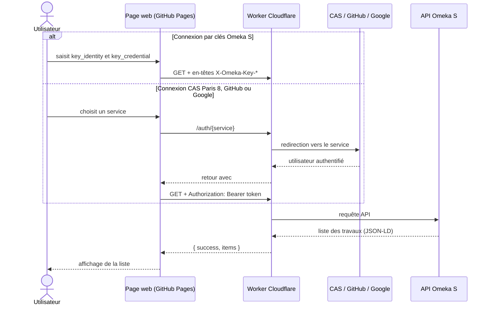

# Artificial Inquiries — Exercice 13

## 1. Présentation de l'exercice

L'exercice **Ex13 — Setting Up the Example** consiste à choisir un travail
professionnel exemplaire, à expliquer son contexte et à évaluer les
caractéristiques qui le rendent pertinent : les pratiques qu'il incarne, les
valeurs qu'il défend et la manière dont il reflète des standards
professionnels. Il comporte deux parties :

-   **Ex13a — Mapping Exemplary Patterns / Playground** : évaluation du travail
    choisi selon huit critères notés de 1 à 5, puis représentation des notes
    sous forme de graphique radar.
-   **Ex13b — Fill in the Blanks** : rédaction d'un paragraphe à trous
    justifiant le caractère exemplaire du travail choisi.

L'exemple retenu est **Wikipédia**, en tant que modèle de documentation
collaborative et de partage de connaissances. L'analyse porte sur le genre de
l'**article encyclopédique collaboratif** : ses pratiques de rédaction, de
vérification des sources et de collaboration entre contributeurs.

## 2. Objectifs

1.  Décrire le contexte et l'intérêt de l'exemple retenu.
2.  L'évaluer selon les huit critères de l'exercice.
3.  Visualiser l'évaluation avec un graphique radar.
4.  Rédiger une justification structurée de son caractère exemplaire.
5.  Décrire les données dans un modèle de classes réutilisable (Mermaid).
6.  Organiser et documenter les ressources du projet dans Omeka S.
7.  Proposer une application web qui se connecte à l'Omeka S commun avec
    plusieurs modes d'authentification et permet de gérer les travaux
    exemplaires (création, lecture, modification, suppression).

## 3. Ex13a — Évaluation selon les huit critères

Chaque critère est noté de **1 à 5**.

| Critère | Question posée | Note | Justification |
|---|---|:-:|---|
| Frequency | À quelle fréquence ce type de texte est-il produit ou consulté ? (1 : exceptionnellement, 5 : en routine) | **5** | Wikipédia est consulté quotidiennement, et des articles sont créés ou modifiés en continu. |
| Professional Stakes | Quelles conséquences sa réussite ou son échec a-t-il sur la réputation ? (1 : faible impact, 5 : critique) | **4** | Un article erroné nuit à la crédibilité de l'encyclopédie et à celle de ses contributeurs, et il est largement repris. |
| Expertise Required | Le travail demande-t-il des connaissances spécialisées ? (1 : connaissances de base, 5 : très spécialisé) | **3** | Tout le monde peut contribuer, mais il faut maîtriser les règles (neutralité, sourçage, syntaxe wiki) et connaître le sujet. |
| Effort and Resources | Combien de temps, d'effort et d'outils sa production demande-t-elle ? (1 : effort minimal, 5 : investissement important) | **4** | Un bon article demande de la recherche documentaire, de la rédaction et de nombreuses relectures successives. |
| Collaboration | Dans quelle mesure l'écriture est-elle collaborative ? (1 : individuelle, 5 : très collaborative) | **5** | C'est le principe même de Wikipédia : écriture collective, pages de discussion, historique des contributions. |
| Error Tolerance | À quel point est-il essentiel que le document soit sans erreur ? (1 : tolère les erreurs, 5 : aucune marge d'erreur) | **5** | L'exigence de vérifiabilité impose que chaque affirmation soit sourcée, et les erreurs sont traquées et corrigées. |
| Standardisation | À quel point ce type de texte est-il standardisé ? (1 : très dépendant du contexte, 5 : très standardisé) | **4** | Les articles suivent des conventions communes (résumé introductif, sections, infobox, références), qui s'adaptent selon les sujets. |
| Professional Pride | Dans quelle mesure ce type de document contribue-t-il au sentiment d'accomplissement ? (1 : faible, 5 : élevé) | **4** | Contribuer à un savoir partagé et voir un article reconnu (« article de qualité ») est valorisant. |

### Graphique radar

Le profil montre un document **très fréquent, très collaboratif et exigeant
sur la fiabilité**, tout en restant accessible : l'expertise requise est la
note la plus basse.

## 4. Ex13b — Fill in the Blanks

> Ce travail est exemplaire parce qu'il **[1]** rend accessible à tous un
> savoir encyclopédique, gratuit et continuellement mis à jour, ce qui est
> essentiel dans le domaine de **[2]** la documentation et de la médiation de
> l'information. Il répond **[3]** au problème de la diffusion de
> connaissances fiables à grande échelle, en proposant **[4]** un modèle
> d'écriture ouvert, où n'importe qui peut contribuer, corriger et discuter
> les contenus. Ce travail se distingue par **[5]** sa traçabilité :
> l'historique de chaque modification et les pages de discussion sont
> publics, et chaque affirmation est rattachée à une source. Il reflète **[6]**
> des valeurs professionnelles telles que la neutralité, la vérifiabilité, la
> transparence et l'amélioration continue. Ce que j'aimerais le plus
> reproduire de ce travail, c'est **[7]** sa manière de structurer
> l'information et de documenter chaque contribution, car cela rejoint
> **[8]** mon objectif de produire une documentation compréhensible,
> vérifiable et réutilisable dans mes projets.

Légende des blancs : [1] contribution principale · [2] profession ou
discipline · [3] problème ou défi précis · [4] solution ou perspective
originale · [5] qualité distinctive · [6] valeurs ou standards professionnels ·
[7] aspect à imiter · [8] raison pour laquelle il rejoint mes objectifs ou mes
pratiques.

## 5. Application web : connexion et CRUD

L'application (`index.html`) est publiée avec GitHub Pages. Elle permet de
gérer les **travaux exemplaires** enregistrés dans l'Omeka S commun.

**Application en ligne :** *(ajouter ici le lien GitHub Pages du dépôt)*

### Architecture

La page ne parle pas directement à Omeka S. Elle passe par un **Worker
Cloudflare** qui sert d'intermédiaire : il vérifie l'authentification,
transmet les requêtes à l'API d'Omeka S et renvoie les résultats.

Adresse du Worker : `https://artificial-inquiries-api.ineskasdi03.workers.dev/`

### Modes d'authentification

| Méthode | Fonctionnement |
|---|---|
| **Omeka S** | L'utilisateur saisit ses propres clés API (*Mon compte → Clés API* dans Omeka S). Elles sont envoyées au Worker dans les en-têtes `X-Omeka-Key-Identity` et `X-Omeka-Key-Credential`. Les clés sont vérifiées en chargeant la liste des travaux. |
| **CAS Paris 8** | Redirection vers le CAS de l'université via `/auth/cas`. |
| **GitHub** | Redirection vers GitHub (OAuth) via `/auth/github`. |
| **Google** | Redirection vers Google (OAuth) via `/auth/google`. |

Pour CAS, GitHub et Google, le Worker renvoie une **session signée**
(`#token=...` dans l'URL). La page la lit, efface le fragment de l'URL, puis
l'envoie au Worker dans l'en-tête `Authorization: Bearer`. Le nom de
l'utilisateur et le service utilisé s'affichent dans la barre du haut.

**Sécurité :**
- les clés et le jeton sont stockés dans `sessionStorage` : ils sont effacés à
  la fermeture de l'onglet ou avec le bouton « Se déconnecter » ;
- en cas de réponse **401** (clés ou session refusées), l'utilisateur est
  déconnecté automatiquement ;
- les contenus venant d'Omeka S sont affichés avec `textContent`, sans
  injection de HTML, et seuls les liens `http`/`https` sont rendus cliquables.

### Opérations CRUD

Toutes les requêtes sont envoyées au Worker, avec la méthode HTTP
correspondante.

| Opération | Méthode | Données envoyées | Effet dans Omeka S |
|---|---|---|---|
| **Create** | `POST` | `title`, `description`, `domain`, `url` | Crée un nouvel item |
| **Read** | `GET` | — | Liste les travaux exemplaires |
| **Update** | `PUT` | `id` + champs modifiés | Met à jour l'item |
| **Delete** | `DELETE` | `id` | Supprime l'item (après confirmation) |

### Propriétés Omeka S utilisées

| Champ du formulaire | Propriété |
|---|---|
| Titre | `o:title` (`dcterms:title`) |
| Description | `dcterms:description` |
| Domaine professionnel | `artinq:domaineProfessionnel` |
| URL de référence | `artinq:url` |

### Tester l'application

1. Ouvrir l'application en ligne.
2. Se connecter avec l'une des quatre méthodes. Le message « Connexion à
   Omeka S réussie » et le nombre de travaux s'affichent.
3. **Create** : remplir le formulaire et cliquer sur « Ajouter le travail ».
4. **Read** : vérifier que le nouveau travail apparaît dans la liste, avec son
   identifiant Omeka S.
5. **Update** : cliquer sur « Modifier », changer un champ, puis enregistrer.
6. **Delete** : cliquer sur « Supprimer » et confirmer.
7. Cliquer sur « Se déconnecter » et vérifier qu'on revient à l'écran de
   connexion.

## 6. Solutions techniques

### GitHub

Le dépôt `ArtificialInquiries_13` versionne les fichiers du projet et
documente les choix effectués.

### Mermaid

Le fichier [`diagram_class.md`](diagram_class.md) contient un diagramme de
classes Mermaid. Il modélise l'exemple étudié, les critères, les évaluations,
les notes et la justification textuelle. Il s'affiche directement sur GitHub
et peut être testé sur [Mermaid Live Editor](https://mermaid.live/).

### Omeka S

Omeka S sert à organiser les ressources documentaires de l'exercice et à les
décrire avec des métadonnées. Le graphique radar n'est pas calculé par Omeka S
: il est produit à part (`radar_ex13a.png`), puis associé à une ressource
Omeka S comme média.

### Technologies utilisées

-   **HTML / CSS / JavaScript** : interface de l'application, sans framework
-   **GitHub Pages** : hébergement de la page
-   **Cloudflare Workers** : intermédiaire sécurisé entre la page et Omeka S,
    gestion de l'authentification
-   **Omeka S** (API REST) : stockage des travaux et de leurs métadonnées
-   **CAS Paris 8, GitHub OAuth, Google OAuth** : authentification externe
-   **Mermaid** : représentation du modèle de données
-   **Git/GitHub** : versionnement et collaboration

Pour une installation locale d'Omeka S : **Apache** (serveur HTTP), **PHP**
(exécution d'Omeka S) et **MySQL** (base de données).

## 7. Installation et test d'Omeka S en local

1.  Installer Apache, PHP, MySQL et les extensions PHP requises.
2.  Télécharger Omeka S depuis le site officiel et placer les fichiers dans le
    répertoire servi par Apache.
3.  Créer une base de données MySQL et un utilisateur dédié.
4.  Renseigner `config/database.ini` avec les identifiants de la base.
5.  Ouvrir l'adresse locale dans un navigateur et suivre l'assistant
    d'installation.
6.  Créer le compte administrateur et terminer la configuration.
7.  Créer un contenu de test et vérifier qu'il est enregistré et consultable.

Documentation officielle : https://omeka.org/s/docs/user-manual/install/

### Résultats des tests

| Test | Résultat |
|---|---|
| Versions installées (Apache / PHP / MySQL / Omeka S) | *à compléter* |
| Page d'accueil locale d'Omeka S affichée | *OK / KO* |
| Accès à l'administration | *OK / KO* |
| Création et enregistrement d'un contenu de test | *OK / KO* |
| Métadonnées du contenu visibles | *OK / KO* |
| Erreurs rencontrées et solutions | *à compléter* |

## 8. Collaborateur GitHub

Le compte **`samszo`** est ajouté comme collaborateur du dépôt
(**Settings → Collaborators → Add people**).

## 9. Fichiers du dépôt

-   `index.html` : application web (connexion et CRUD sur Omeka S)
-   `README.md` : description, évaluation, justification, application,
    solutions techniques et protocole de test
-   `radar_ex13a.png` : graphique radar de l'évaluation Ex13a
-   `diagram_class.md` : diagramme de classes Mermaid
-   `captures_formulaire/` : captures des formulaires de l'exercice

## 10. Références

-   *Artificial Inquiries*, exercices Ex13, Ex13a et Ex13b
-   Documentation d'installation d'Omeka S :
    https://omeka.org/s/docs/user-manual/install/
-   Syntaxe des diagrammes de classes Mermaid :
    https://mermaid.js.org/syntax/classDiagram.html
-   API REST d'Omeka S :
    https://omeka.org/s/docs/developer/api/rest_api/
-   Cloudflare Workers : https://developers.cloudflare.com/workers/
-   Wikipédia, principes fondateurs :
    https://fr.wikipedia.org/wiki/Wikipédia:Principes_fondateurs

## 11. Captures des formulaires de l'exercice

### Ex13 — Setting Up the Example

### Ex13a — Instructions et critères

### Ex13a — Tableau des critères

### Ex13a — Graphique radar vierge

### Ex13b — Fill in the Blanks

